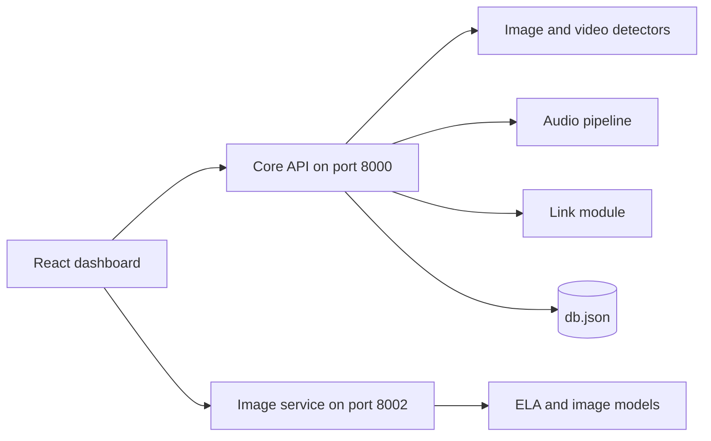

# Multimodal Fake Content Detector


A research prototype for detecting AI-generated and manipulated media, also named PixelDNA in its commit history. The project combines signal-processing techniques with pretrained neural models to analyze images, video, and audio, and presents the results through a React dashboard.

> **Notice:** This is a prototype for demonstration and learning. Its results have not been formally evaluated and should not be used as evidence or as the sole basis for decisions about the authenticity of media.

## Overview

The system exposes a FastAPI gateway for analysis requests and a separate image analysis service. Each media type has its own pipeline that produces a score, a verdict, and supporting findings. The dashboard handles uploads, shows the results, and keeps a history of past scans.

## Implementation Status

| Module | Status | Notes |
| --- | --- | --- |
| Image analysis | Implemented | Pretrained detectors, Error Level Analysis, and metadata checks |
| Video analysis | Implemented | Frame sampling with pretrained deepfake detectors |
| Audio analysis | Implemented | Six-phase pipeline combining signal analysis with a Wav2Vec2 model |
| Multimodal analysis | Partial | Combines the image, video, and audio scores; cross-modal functions are outlined in pseudocode |
| Link analysis | Demonstration | Does not download or analyze media; returns reference entries or generated placeholder results |
| `advanced_*.py` and training scripts | Research outlines | Marked in the source as pseudo-implementations |

Analysis endpoints also accept an `X-Bypass-Code` header, which forces a chosen result for demonstration purposes.

## Key Features

- Error Level Analysis for images
- AI-image and deepfake classification using pretrained Hugging Face models
- Frame-based video analysis
- Audio analysis covering spectral features, pitch and timing, speaker consistency, and file metadata
- Rule-based weighted fusion for the audio verdict
- Login and a dashboard summarizing past scans

## Technology Stack

| Layer | Technology |
| --- | --- |
| Frontend | React 19, TypeScript, Vite, Tailwind CSS, Zustand, TanStack Query, Recharts, Framer Motion |
| Backend | FastAPI, Uvicorn |
| Machine learning | PyTorch, Hugging Face Transformers, timm |
| Media processing | OpenCV, Pillow, piexif, librosa, soundfile, SciPy, mutagen |
| Storage | Local `db.json` file |

## Architecture and Workflow



## Project Structure

```text
MFD_AI/
├── api.py                  Core API gateway
├── image_detector.py       Image detection
├── video_detector.py       Video detection
├── link_analyzer.py        Link analysis demonstration
├── audio_analysis/         Audio pipeline and modules
├── image_analysis/         Image analysis service
├── video_analysis/         Video analysis modules
├── models/                 Model weights
├── frontend/               React dashboard
├── advanced_*.py           Research outlines
├── nexus_*.py              Training pipeline outlines
└── requirements.txt
```

## Installation and Setup

### Prerequisites

- Python 3.10 or later
- Node.js 18 or later
- FFmpeg on the system path

### Backend

```bash
git clone https://github.com/Partha-Shankar/MFD_AI.git
cd MFD_AI
python -m venv venv
```

Activate the virtual environment:

```bash
source venv/bin/activate      # Linux and macOS
venv\Scripts\activate         # Windows
```

Install the dependencies:

```bash
pip install -r requirements.txt
```

### Missing Source Files

Two local modules are imported by the services but are not in the current repository:

- **`link_dataset.py`** is required by `api.py`. It was removed in a later commit and can be restored from history:

  ```bash
  git checkout e1d28f1 -- link_dataset.py
  ```

- **`image_analysis/models/`**, which contains the model loader, is required by the image service. It is excluded by `.gitignore` and must be supplied separately.

### Frontend

```bash
cd frontend
npm install
```

## Configuration

Copy `image_analysis/.env.example` to `image_analysis/.env` to configure the image service.

| Variable | Purpose |
| --- | --- |
| `LOCAL_MODEL_DIR` | Directory containing local model weights |
| `FEEDBACK_LOG_PATH` | Location of the feedback log |
| `IMAGE_ANALYSIS_PORT` | Image service port |
| `CORS_ORIGINS` | Allowed frontend origins |
| `HF_MODEL_CACHE` | Hugging Face model cache |

Some model and cache paths are currently hardcoded for the original development machine, including `D:\huggingface_cache` in `image_analysis/api/main.py` and `D:\.hf_cache` in `audio_analysis/pipeline.py`. Adjust these for your environment.

## Usage

Run each service in its own terminal.

```bash
uvicorn api:app --host 0.0.0.0 --port 8000 --reload
```

```bash
uvicorn image_analysis.api.main:app --host 0.0.0.0 --port 8002 --reload
```

```bash
cd frontend
npm run dev
```

Then open `http://localhost:5173`.

### API Reference

| Method | Path | Purpose |
| --- | --- | --- |
| POST | `/auth/signup`, `/auth/login` | Create an account or log in |
| GET | `/user/profile` | Retrieve the current user |
| GET | `/analysis/history` | Retrieve scan history |
| POST | `/analyze/image` | Analyze an image |
| POST | `/analyze/video` | Analyze a video |
| POST | `/analyze/audio` | Analyze an audio file |
| POST | `/analyze/link` | Link analysis demonstration |
| POST | `/analyze/multimodal` | Analyze multiple media types together |

## Technical Implementation

### Models

| Model | Used For | Source |
| --- | --- | --- |
| `Organika/sdxl-detector` | AI-generated images | Hugging Face |
| `umm-maybe/AI-image-detector` | AI-generated images | Hugging Face |
| `openai/clip-vit-base-patch32` | Image context | Hugging Face |
| `prithivMLmods/deepfake-detector-model-v1` | Video frames | Hugging Face |
| `dima806/deepfake_vs_real_image_detection` | Video frames | Hugging Face |
| `facebook/wav2vec2-base-960h` | Audio features | Hugging Face |
| `models/ai_detector_best.pth`, `models/model.pth` | Local weights | Repository |

### Audio Pipeline

| Phase | Component | Analysis |
| --- | --- | --- |
| 0 | Neural model | Wav2Vec2-based classification |
| 1 | Spectral analyzer | Mel spectrogram, FFT, phase, and noise floor |
| 2 | Temporal analyzer | Pitch jitter, breathing, prosody, and pauses |
| 3 | Speaker analyzer | Embedding drift and voice consistency |
| 4 | Metadata analyzer | Format, encoder, and bitrate |
| 5 | Verdict engine | Weighted fusion and rule-based verdict |

## Future Scope

- Formal evaluation on benchmark deepfake datasets
- A working link pipeline that downloads and analyzes media
- Implementation of the cross-modal fusion outlines
- Secure credential storage for user accounts
